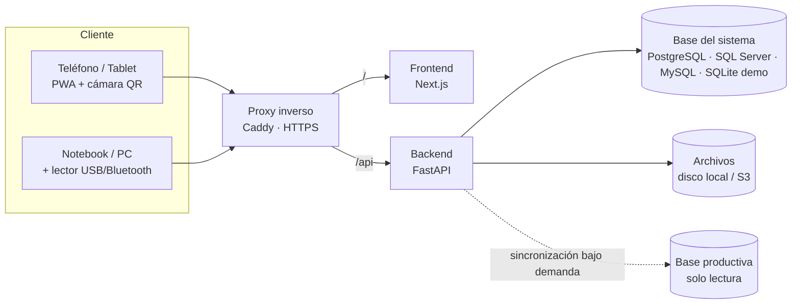
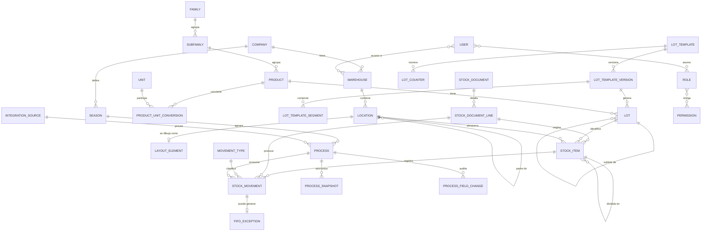
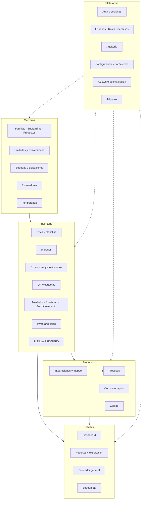
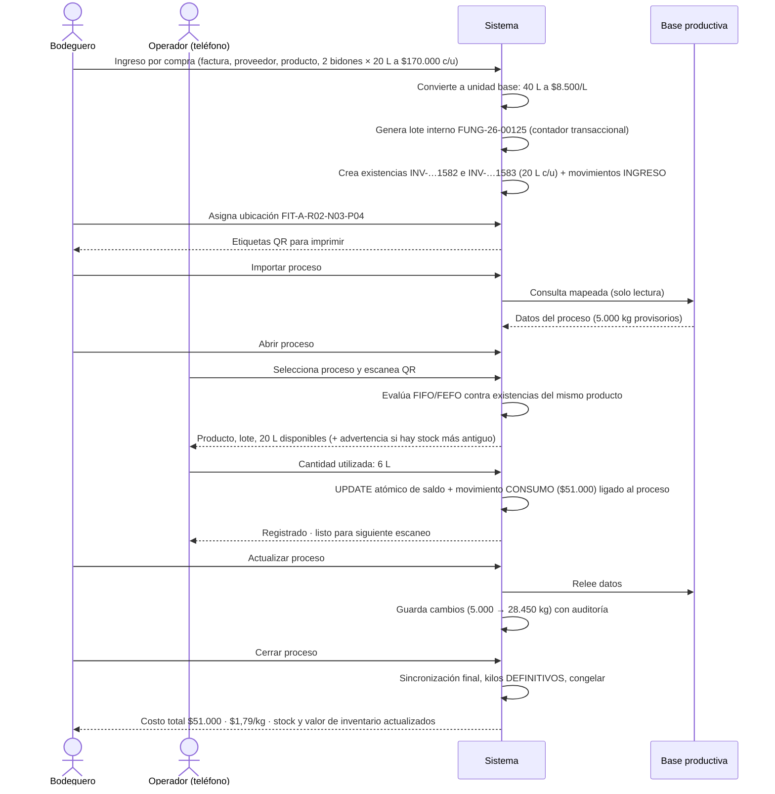
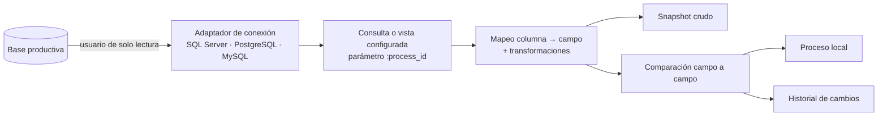

# Sistema de Gestión de Bodegas e Inventario — Análisis inicial

Fecha: 2026-10-06 · Estado: **análisis previo a implementación** (no hay código todavía)

Este documento responde la "Primera tarea" (puntos A–W). Las decisiones marcadas **[D]** son recomendaciones que quedan firmes salvo objeción; las marcadas **[P]** dependen de una respuesta de la sección V.

---

## Revisión 2 — Decisiones aprobadas (2026-10-06)

El análisis fue aprobado con las correcciones siguientes. **Donde esta sección contradiga al resto del documento, prevalece esta sección.** El modelo físico vigente está en `docs/DATABASE.md`.

| # | Decisión |
|---|---|
| R1 | **Un motor por instalación.** Al instalar se elige SQL Server, PostgreSQL, MySQL o Modo Demo (SQLite). No hay cambio de motor en caliente. La persistencia se mantiene portable (tipos genéricos, sin SQL propietario), pero no se construye infraestructura para operar varios motores a la vez. La sección D.3 y el riesgo U.1 se leen en ese sentido. |
| R2 | **Modo Demo como herramienta comercial.** Levanta con un comando, sobre SQLite, con datos ficticios completos (maestros, lotes, existencias, QR, procesos, consumos, reservas, alertas, bodega 2D/3D) y una fuente productiva simulada para demostrar sincronización. |
| R3 | **Nombres físicos en español**, `snake_case`, sin tildes ni ñ, en tablas y columnas. Los nombres en inglés de las secciones E, G y H quedan reemplazados según la tabla de equivalencias de abajo. La API también usa rutas en español (`/api/productos`, `/api/existencias`). |
| R4 | **Granularidad de inventario configurable y heredable** (familia → subfamilia → producto): `POR_ENVASE`, `POR_LOTE`, `CONSOLIDADA`, `UNIDAD_LOGISTICA`. Responde la pregunta V.1. |
| R5 | Estrategia de recomendación: `FIFO`, `FEFO`, `FEFO_FIFO`, `SIN_RECOMENDACION`. Política: `ADVERTIR`, `BLOQUEAR`, `JUSTIFICAR`, `PERMISO`. |
| R6 | **Base de costeo por kilo configurable.** El proceso guarda `kilos_recepcionados`, `kilos_procesados`, `kilos_producidos`, `kilos_despachados` y campos adicionales. Predeterminado: kilos procesados. |
| R7 | **Cierre de proceso:** acción principal "Actualizar y cerrar"; "Cerrar sin actualizar" exige permiso. Se registra última sincronización, modo de cierre, kilos definitivos, usuario y fecha. |
| R8 | **Reservas de stock** (nuevo módulo). Stock físico − reservado = disponible. Reservar no descuenta; el consumo relacionado reduce o cierra la reserva. Estados: ACTIVA, CONSUMIDA, LIBERADA, VENCIDA, ANULADA. |
| R9 | **Centro de alertas** (nuevo módulo) con entidad persistente, reglas configurables, estados y severidades; preparado para canales de notificación futuros. |
| R10 | **Trazabilidad visual** (nueva pantalla), navegable hacia adelante (lote → procesos) y hacia atrás (proceso → documentos). |
| R11 | Documentos de inventario con estados BORRADOR / CONFIRMADO / ANULADO. |
| R12 | Consumo rápido muestra **últimos consumos** con anulación por movimiento inverso. |
| R13 | Alcance opcional de usuario por **familia de productos**, además de bodega. Permiso independiente para ver costos. |
| R14 | Visor 3D básico disponible antes del editor avanzado, para que el Demo lo muestre. |
| R15 | Sin Airflow. Tareas internas con APScheduler. |
| R16 | Estrategia documentada de respaldo y restauración por motor. |

**Equivalencia de nombres** (inglés del análisis → nombre físico):

| Análisis | Físico | Análisis | Físico |
|---|---|---|---|
| companies | empresas | lots | lotes |
| users / roles / permissions | usuarios / roles / permisos | lot_templates | plantillas_lotes |
| user_roles / role_permissions | usuarios_roles / roles_permisos | lot_template_versions | versiones_plantillas_lotes |
| user_warehouses | usuarios_bodegas | lot_template_segments | segmentos_plantillas_lotes |
| — | usuarios_familias | lot_counters | contadores_lotes |
| refresh_tokens | sesiones | stock_documents | documentos_inventario |
| audit_logs | auditoria | stock_document_lines | detalles_documentos_inventario |
| settings | configuraciones | stock_items | existencias |
| attachments | adjuntos | stock_movements | movimientos_inventario |
| number_sequences | secuencias | fifo_exceptions | excepciones_fifo |
| seasons | temporadas | — | reservas_stock |
| units | unidades_medida | stock_counts / _lines | conteos_inventario / detalles_conteos_inventario |
| unit_conversions + product_unit_conversions | conversiones_unidades | loans | prestamos |
| families / subfamilies / products | familias / subfamilias / productos | processes | procesos |
| suppliers | proveedores | process_snapshots | capturas_procesos |
| warehouses / warehouse_types | bodegas / tipos_bodega | process_field_changes | cambios_procesos |
| locations | ubicaciones | integration_connections | conexiones_integracion |
| layout_elements | elementos_plano | integration_sources | fuentes_integracion |
| movement_types | tipos_movimiento | integration_field_mappings | mapeos_integracion |
| reason_types | motivos_movimiento | integration_sync_runs | ejecuciones_sincronizacion |
| label_templates | plantillas_etiquetas | — | alertas / reglas_alertas |

Roadmap vigente: ver `docs/PROJECT_STATUS.md`.

---

## A. Resumen funcional

Sistema web responsive para administrar inventario industrial multi-bodega, con primera etapa en **fitosanitarios** y arquitectura parametrizable para pañoles, repuestos, EPP y otros.

El sistema gira en torno a cinco ideas:

1. **Existencia** — cada ingreso físico crea una o más *existencias* identificables (`INV-000001582`), cada una con su lote interno, fecha de ingreso, ubicación, cantidad disponible y **costo unitario propio**. El QR identifica la existencia, no el producto.
2. **Libro de movimientos inmutable** — el stock nunca se edita: se registra un movimiento. Las correcciones son anulaciones o movimientos inversos.
3. **Lote interno configurable** — un generador por segmentos y plantillas versionadas produce el código de lote, con correlativos transaccionales.
4. **Consumo rápido contra proceso** — desde el teléfono: elegir proceso → escanear QR → digitar cantidad → registrar. El sistema advierte o bloquea según política FIFO/FEFO y valoriza el consumo con el costo exacto de la existencia.
5. **Proceso productivo como copia local** — los procesos se importan y actualizan desde la base productiva mediante mapeo configurable; al cerrar quedan congelados y permiten calcular costo total y costo por kilo, analizable por especie, productor, variedad, temporada, etc.

Alrededor de eso: maestros parametrizables (familias, subfamilias, productos, unidades, conversiones), bodega 3D, traslados, préstamos, inventario físico, fraccionamiento, RBAC con alcance por bodega, auditoría, dashboard, reportes exportables, asistente de instalación y modo demo.

---

## B. Arquitectura recomendada

**Monolito modular** con frontend y backend separados, detrás de un proxy inverso en el mismo origen.



Backend por capas, un paquete por módulo de dominio:

```
backend/app/
  core/            config, seguridad, db, errores, auditoría, numeración
  modules/
    auth/  users/  catalog/  warehouses/  lots/  inventory/
    processes/  integrations/  dashboard/  reports/  settings/  install/
      router.py      ← HTTP, validación, permisos
      schemas.py     ← Pydantic (contrato API)
      service.py     ← reglas de negocio, transacciones
      models.py      ← SQLAlchemy
      repository.py  ← consultas
```

Reglas de dependencia: `router → service → repository/models`. Un módulo solo usa a otro a través de su `service`. Así un módulo nuevo (p. ej. *herramientas con serie*) se agrega sin tocar los existentes.

**[D] Monolito modular, no microservicios.** Un equipo pequeño, una base de datos y transacciones que cruzan inventario + lotes + procesos: microservicios agregarían transacciones distribuidas sin ningún beneficio a esta escala.

---

## C. Tecnologías recomendadas

| Capa | Elección | Nota |
|---|---|---|
| Frontend | Next.js (App Router) + React + TypeScript | Como SPA autenticada; sin acceso a BD |
| UI | Tailwind CSS + shadcn/ui | Tablas: TanStack Table. Gráficos: Recharts |
| Datos en cliente | TanStack Query + cliente tipado generado desde OpenAPI | Tipos compartidos sin duplicar |
| Formularios | React Hook Form + Zod | Validación en cliente; el backend revalida siempre |
| 3D | Three.js + React Three Fiber + drei | Carga diferida, solo en el módulo de bodega |
| QR lectura | `BarcodeDetector` nativo donde exista; respaldo ZXing (WASM) | Lectores USB/Bluetooth como teclado |
| QR/etiquetas | Generación en backend (`segno`) + PDF (`reportlab`) | ZPL para Zebra como extensión |
| i18n | `next-intl` | Español por defecto; el asistente pide idioma |
| Backend | Python 3.12 + FastAPI + Pydantic v2 | OpenAPI/Swagger automático |
| ORM / migraciones | SQLAlchemy 2.0 (modo **síncrono**) + Alembic | Ver D.2 |
| Drivers | `psycopg` 3 · `pyodbc` (ODBC 18) · `PyMySQL` · `sqlite3` | |
| Autenticación | JWT de acceso corto + refresh rotativo en cookie httpOnly | Hash Argon2id |
| Tareas programadas | APScheduler dentro del backend | Sin Celery/Redis en esta etapa |
| Exportación | `openpyxl` (Excel), CSV nativo, `reportlab` (PDF) | |
| Pruebas | pytest + httpx · Vitest + Testing Library · Playwright (flujos críticos) | |
| Despliegue | Docker Compose + Caddy | HTTPS obligatorio (cámara) |

---

## D. Justificación técnica

**D.1 FastAPI + Next.js (se mantiene la referencia propuesta).** Python facilita la integración con SQL Server/ODBC y la lógica de costos con `Decimal`; Next.js + shadcn da una UI industrial moderna con poco esfuerzo. Alternativa descartada: todo en Next.js (API routes + Prisma) — Prisma no ofrece el mismo control transaccional multi-motor y el equipo ya trabaja en Python.

**D.2 SQLAlchemy síncrono, no asíncrono.** El driver asíncrono de SQL Server es inmaduro; mantener dos estilos según motor duplicaría pruebas. FastAPI ejecuta los endpoints síncronos en un pool de hilos, suficiente para decenas de usuarios concurrentes. Desventaja: menor techo de concurrencia, irrelevante a esta escala.

**D.3 Tres motores + SQLite: disciplina de portabilidad.** Es el requisito más caro del proyecto (ver U.1). Consecuencias de diseño:

- Solo tipos portables: `Numeric`, `String`, `DateTime`, `Boolean`, `JSON` genérico. Nada de JSONB, arrays, índices parciales, secuencias nativas ni `RETURNING` como dependencia.
- Los campos JSON se usan solo como *bolsa de atributos* (nunca en `WHERE` de lógica de negocio).
- Correlativos mediante tabla de contadores, no secuencias.
- Concurrencia mediante `UPDATE` atómico condicional, no `SELECT … FOR UPDATE` (su soporte no es uniforme entre motores).
- CI ejecuta la suite completa contra los cuatro motores.

**D.4 Proxy en mismo origen.** Frontend en `/`, API en `/api`. Evita CORS, permite cookie `SameSite=Strict` para el refresh token y entrega HTTPS, sin el cual los navegadores móviles no abren la cámara.

**D.5 Sin colas ni caché externa.** Sincronización y reportes se resuelven en línea o con APScheduler. Se agregan Redis/colas solo si aparece una necesidad medida.

**D.6 Configuración de arranque fuera de la BD.** El asistente de instalación escribe la conexión en un archivo local cifrado (`instance/config.enc`) con una clave tomada de variable de entorno. Sin ese archivo el backend arranca en "modo instalación" y solo expone `/api/install/*`.

---

## E. Modelo conceptual de datos



Conceptos clave:

- **Lote ≠ existencia.** Un lote es la identidad de trazabilidad; una existencia (`STOCK_ITEM`) es una cantidad física concreta de ese lote, en una ubicación, con un costo. Un lote puede tener varias existencias (varios envases, o partes trasladadas).
- **La existencia es la capa de costo.** No existe una tabla de capas aparte: cada existencia lleva su `unit_cost` inmutable.
- **El consumo es un movimiento.** No hay tabla `process_consumptions` separada: es un `STOCK_MOVEMENT` de tipo consumo con `process_id`. Una sola fuente de verdad; los reportes usan una vista.

---

## F. Diagrama de módulos



---

## G. Principales tablas

La lista candidata del requerimiento se revisó. Cambios respecto a ella:

| Candidata | Decisión | Motivo |
|---|---|---|
| `inventory_entries` | → `stock_items` | Es la existencia con QR; "entry" se confunde con ingreso |
| `inventory_balances` | **Eliminada** (vista) | `stock_items.qty_available` ya es el saldo; una tabla agregada sería un segundo saldo que puede desincronizarse |
| `inventory_movements` + `_details` | → `stock_documents` / `_lines` + `stock_movements` | Separa el documento operativo (editable en borrador) del libro contable (inmutable) |
| `documents` | Absorbida en `stock_documents` | Tipo y número de documento son atributos del ingreso |
| `process_consumptions` | **Eliminada** (vista) | Es un movimiento con `process_id` |
| `process_external_data` | → `process_snapshots` | Guarda cada lectura cruda, no solo la última |
| `warehouse_zones` | Absorbida en `locations` | Jerarquía configurable de N niveles en una sola tabla |
| — | **Nuevas**: `location_level_types`, `layout_elements`, `lot_template_versions`, `lot_counters`, `lot_template_assignments`, `number_sequences`, `movement_types`, `reason_types`, `fifo_exceptions`, `user_warehouses`, `label_templates`, `attribute_definitions`, `unit_conversions`, `integration_sync_runs`, `lot_status_history` | |

### Plataforma

| Tabla | Propósito | Columnas clave |
|---|---|---|
| `companies` | Empresa (base multiempresa) | code, name, tax_id, currency, timezone |
| `users` | Usuarios | company_id, username, email, password_hash, is_active |
| `roles`, `permissions`, `role_permissions`, `user_roles` | RBAC | permission.code = `modulo:accion` |
| `user_warehouses` | Alcance por bodega | user_id, warehouse_id |
| `refresh_tokens` | Sesiones revocables | user_id, token_hash, expires_at, revoked_at, device |
| `audit_logs` | Auditoría | user_id, at, ip, device, entity, entity_id, action, old_value, new_value, reason |
| `settings` | Parámetros | scope (global/empresa/bodega), key, value |
| `attachments` | Archivos | entity_type, entity_id, kind, storage_path, mime, size, sha256 |
| `number_sequences` | Correlativos de sistema (INV, documentos) | company_id, key, last_value |

### Maestros

| Tabla | Propósito | Columnas clave |
|---|---|---|
| `seasons` | Temporadas | code, start_date, end_date, is_current |
| `units` | Unidades | code, name, dimension (masa/volumen/conteo/longitud), decimals |
| `unit_conversions` | Conversiones universales | from_unit, to_unit, factor (kg↔g, L↔ml) |
| `product_unit_conversions` | Conversiones por producto | product_id, from_unit, to_unit, factor (bidón→20 L) |
| `families`, `subfamilies` | Clasificación | code, name + **columnas de política heredable** |
| `products` | Maestro | códigos, nombre, subfamily_id, unidades base/compra/consumo, costo ref., mín/máx/reposición, barcode, attributes (JSON) + política |
| `attribute_definitions` | Atributos configurables | family_id, key, label, type, required, options |
| `suppliers` | Proveedores | code, name, tax_id |
| `warehouse_types`, `warehouses` | Bodegas | code, name, dimensiones, code_pattern |
| `location_level_types` | Niveles de jerarquía por bodega | warehouse_id, depth, name (Pasillo/Rack/Nivel/Posición), code_prefix |
| `locations` | Árbol de ubicaciones | warehouse_id, parent_id, level_type_id, code, full_code (único), path, capacity, is_storable, is_active |
| `layout_elements` | Geometría 3D | warehouse_id, location_id, kind (rack/zona/piso/pasillo/muro), x,y,z, w,d,h, rotation, params (JSON), layout_version |
| `movement_types` | Tipos de movimiento | code, name, direction (+1/−1/0), is_system |
| `reason_types` | Tipos de ingreso/salida | kind (ingreso/salida), code, name, requires_process, requires_document |

**Política heredable** (mismas columnas, anulables, en `families`, `subfamilies` y `products`; `NULL` = heredar): `uses_lot`, `uses_expiry`, `uses_serial`, `requires_qr`, `requires_location`, `stock_item_granularity`, `picking_strategy` (FIFO/FEFO/FEFO→FIFO), `fifo_policy`, `shelf_life_months`, `expiry_priority`, `open_shelf_life_days`, `lot_template_id`, `default_unit_id`. Un servicio resuelve producto → subfamilia → familia → parámetro global.

### Lotes

| Tabla | Propósito | Columnas clave |
|---|---|---|
| `lot_templates` | Plantilla | code, name, mode (auto/semi/manual), creation_moment, is_active |
| `lot_template_versions` | Versionado | template_id, version, valid_from, valid_to, counter_scope (JSON), reset_policy |
| `lot_template_segments` | Segmentos | version_id, position, type, config (JSON) |
| `lot_template_assignments` | Asociación | template_id, family_id / subfamily_id / product_id |
| `lot_counters` | Correlativos | template_id, scope_key, last_value — único (template_id, scope_key) |
| `lots` | Lote interno | company_id, code (**único por empresa**), product_id, template_version_id, parent_lot_id, fechas (creación, fabricación, vencimiento), status, external_reference, created_by |
| `lot_status_history` | Cambios de estado | lot_id, from, to, user, at, reason |

### Inventario

| Tabla | Propósito | Columnas clave |
|---|---|---|
| `stock_documents` | Cabecera de operación | kind (ingreso/salida/traslado/ajuste/conteo), reason_type_id, doc_type, doc_number, doc_date, supplier_id, warehouse_id, process_id, status (borrador/confirmado/anulado), currency |
| `stock_document_lines` | Detalle | product_id, qty, unit_id, qty_base, unit_price, unit_cost_base, total, lot_id, expiry_date, location_id |
| `stock_items` | **Existencia** | public_code (`INV-…`), qr_token, product_id, lot_id, warehouse_id, location_id, origin_line_id, parent_item_id, entry_date, qty_initial, qty_available, unit_id, unit_cost, currency, cost_date, supplier_id, status, opened_at, opened_by, version |
| `stock_movements` | **Libro inmutable** | at, movement_type_id, stock_item_id, product_id, lot_id, qty (con signo, unidad base), qty_entered, unit_entered, unit_cost, total_cost, warehouse/location origen y destino, process_id, document_line_id, reverses_movement_id, user_id, reason, note, idempotency_key |
| `fifo_exceptions` | Consumos fuera de orden | movement_id, recommended_item_id, strategy, policy_applied, justification, authorized_by |
| `stock_counts`, `stock_count_lines` | Inventario físico | warehouse, location, status; item, qty_system, qty_counted, diff, adjustment_movement_id |
| `loans` | Préstamos | stock_item_id, qty, person, area, loaned_at, due_at, returned_at, status, movimientos asociados |
| `label_templates` | Etiquetas | name, size, fields (JSON), is_default |

### Producción e integración

| Tabla | Propósito | Columnas clave |
|---|---|---|
| `processes` | Copia local | external_id, source_id, code, number, date, start/end, season_id, status, exportadora, productor (código/nombre), campo, predio, especie, variedad, lote externo, kilos, kilos_status (provisorio/definitivo), bins, cajas, turno, línea, guía, extra (JSON), last_synced_at, closed_at |
| `process_snapshots` | Lectura cruda por sincronización | process_id, sync_run_id, payload (JSON), at |
| `process_field_changes` | Auditoría de cambios | process_id, field, old, new, at, user, sync_run_id |
| `integration_connections` | Conexión externa | engine, host, port, database, username, password_encrypted, options |
| `integration_sources` | Vista o consulta | connection_id, kind (vista/consulta), sql_list, sql_detail, id_column |
| `integration_field_mappings` | Mapeo | source_id, external_column, internal_field (o `extra.<clave>`), transform, update_policy |
| `integration_sync_runs` | Historial | source_id, started/finished, status, rows, error |

**Convenciones.** Toda tabla raíz lleva `company_id`. PK enteras autoincrementales (portables). Cantidades `NUMERIC(18,6)`, costos unitarios `NUMERIC(18,6)`, totales `NUMERIC(18,2)`. Fechas en UTC; presentación en zona horaria de la empresa. Borrado lógico (`is_active`) en maestros; nunca borrado físico en movimientos, lotes o existencias.

---

## H. Relaciones e integridad

- `stock_items.lot_id → lots` (anulable si el producto no usa lote); `lots.product_id → products`; por lo tanto `stock_items.product_id` debe coincidir con el del lote (validado en servicio).
- `stock_movements.stock_item_id → stock_items` **obligatorio**: todo movimiento afecta exactamente una existencia. Un traslado genera dos movimientos enlazados por la misma línea de documento.
- `stock_movements.reverses_movement_id → stock_movements`, con índice único: un movimiento se anula una sola vez.
- `locations.parent_id → locations`; `full_code` único por bodega.
- `lots (company_id, code)` único; `stock_items.public_code` y `qr_token` únicos; `lot_counters (template_id, scope_key)` único; `stock_movements.idempotency_key` único.
- `CHECK (qty_available >= 0)`, `CHECK (qty_initial > 0)`, `CHECK (unit_cost >= 0)`, `CHECK (factor > 0)`.
- Índices principales: `stock_items (product_id, warehouse_id, status, entry_date)` para FIFO; `stock_items (lot_id)`; `stock_movements (process_id)`, `(product_id, at)`, `(stock_item_id)`; `lots (expiry_date, status)`; `processes (season_id, status)`, `(external_id, source_id)` único.

**Invariante verificable:** para toda existencia, `qty_available = Σ stock_movements.qty`. Un comando de reconciliación lo comprueba y es parte de las pruebas.

---

## I. Flujo completo



---

## J. Arquitectura de integración con producción



- **Nada se asume** de la base externa: el administrador indica vista o consulta, columna identificadora y mapeo. El sistema lee los metadatos de columnas para ofrecerlos en la interfaz.
- Dos consultas por fuente: **listado** (procesos disponibles para importar, con filtro de fecha) y **detalle** (un proceso por identificador).
- Mapeo visual: columna externa → campo interno conocido (`kilos`, `especie`, …) o campo adicional (`extra.<clave>`). Las columnas no mapeadas pueden guardarse igualmente en el snapshot.
- Transformaciones simples y declarativas: recorte, mayúsculas, conversión numérica/fecha, factor multiplicador. Sin código arbitrario.
- **Seguridad:** credenciales cifradas (Fernet, clave en variable de entorno) y nunca devueltas por la API; se exige usuario de solo lectura; se valida que la consulta sea un único `SELECT`; tiempo máximo y límite de filas; el identificador siempre va como parámetro enlazado.
- Botón **Probar** en conexión, consulta y mapeo (muestra filas de ejemplo ya transformadas).

---

## K. Diseño del creador de lotes

**Modelo.** Una plantilla tiene versiones; cada versión es una lista ordenada de segmentos `{tipo, configuración}`.

| Grupo | Tipos | Configuración |
|---|---|---|
| Literales | texto fijo, separador | valor |
| Fecha | año (2/4), mes (nº/abrev./nombre), día, fecha (5 formatos), fecha-hora | formato, fuente (creación/ingreso/fabricación) |
| Correlativo | correlativo | largo, relleno, inicio, incremento |
| Contexto | producto, familia, subfamilia, bodega, empresa, temporada, usuario, turno, proceso | campo origen, largo máximo, mayúsculas |
| Entrada | campo manual | etiqueta, expresión de validación, obligatorio |

Los tipos "correlativo diario/mensual/anual/global" del requerimiento se modelan como **un** segmento correlativo más dos propiedades de la versión: **alcance** (combinación libre de dimensiones: empresa, bodega, familia, subfamilia, producto, temporada, proceso) y **reinicio** (nunca, diario, mensual, anual, temporada, manual). Menos tipos, todas las combinaciones.

**Motor.** Función pura `render(versión, contexto, correlativo) → código`. La vista previa del constructor usa exactamente la misma función vía API, de modo que lo que se ve es lo que se genera.

**Correlativo transaccional.** La clave del contador se compone de alcance + período, p. ej. `sub=FUNG|y=2026`. El reinicio es implícito: al cambiar el período cambia la clave y el contador parte de nuevo. El reinicio manual incrementa una "época" incluida en la clave.

```
dentro de la MISMA transacción que crea el lote:
  UPDATE lot_counters SET last_value = last_value + 1
   WHERE template_id = :t AND scope_key = :k       ← toma bloqueo de fila
  si no afectó filas → INSERT (…, 1); si choca por unicidad → reintentar
  leer last_value → render → INSERT lots
```

El bloqueo de fila serializa a dos usuarios simultáneos en el mismo alcance; `UNIQUE (company_id, code)` es la última barrera. Como contador y lote comparten transacción, un fallo no deja saltos.

**Validación antes de activar:**

- Genera N ejemplos, incluyendo cruces de período (31-dic → 1-ene).
- **Error** si hay reinicio periódico y el código no incluye ese período (colisión segura).
- **Error** si el alcance incluye una dimensión que el código no refleja (dos productos producirían el mismo código).
- **Advertencia** por desborde (correlativo de 4 dígitos con volumen estimado mayor a 9.999), largo total excesivo, o campo manual sin validación.
- Modo automático exige al menos un correlativo.

**Versionado.** Editar una plantilla activa crea una versión nueva con `valid_from`; la anterior recibe `valid_to`. Cada lote guarda `template_version_id`. Los lotes históricos no cambian.

**Momento de creación.** Configurable. Si se elige "al crear recepción" y la recepción se descarta, el lote queda **ANULADO** (no se reutiliza el número).

**Sublotes.** `parent_lot_id` + sufijo correlativo propio del padre (`-01`, `-02`). El fraccionamiento registra salida de la existencia origen y entrada de N existencias nuevas con el mismo costo unitario y la misma fecha de ingreso.

---

## L. Diseño FIFO / FEFO

**Estrategia** (heredable familia → subfamilia → producto):

| Estrategia | Orden |
|---|---|
| FIFO | `entry_date`, id |
| FEFO | `expiry_date` (sin vencimiento al final), `entry_date` |
| FEFO → FIFO | vencimiento y, a igualdad, ingreso |

**Evaluación al escanear** la existencia X:

1. Candidatas = existencias del mismo producto con saldo > 0, estado disponible, lote DISPONIBLE y no vencido, dentro del **ámbito** (por defecto la misma bodega; configurable).
2. Se ordenan según la estrategia.
3. Si X no es la primera y la diferencia supera la **tolerancia** (por defecto: mismo día cuenta como igual), hay desviación.
4. Se aplica la **política**: solo advertir · bloquear · permitir con justificación · permitir solo con permiso `fifo:override`.
5. La respuesta incluye la existencia recomendada: lote, fecha de ingreso, cantidad, ubicación.
6. Si el consumo procede, se registra `fifo_exceptions`.

La antigüedad usa siempre `entry_date`, nunca el número de lote. Una existencia dividida o trasladada **hereda** la fecha de ingreso original.

Reglas aparte, no negociables por política FIFO: lote BLOQUEADO/CUARENTENA no se consume sin `lots:consume_blocked`; lote vencido requiere permiso propio. Un trabajo diario marca como VENCIDO los lotes cuya fecha pasó.

**Dashboard de antigüedad:** rangos configurables en `settings`; edad = hoy − `entry_date`, ponderada por valor para la edad promedio.

---

## M. Diseño de valorización

**Método: identificación específica por existencia.** Cada existencia conserva el costo unitario de su ingreso, inmutable.

- **Ingreso:** se guardan cantidad, precio y unidad del documento *y* su equivalente en unidad base. `unit_cost_base = precio_unidad_compra / factor`. También moneda, fecha de costo, documento y proveedor.
- **Consumo:** `total_cost = qty × unit_cost` de la existencia escaneada. El movimiento copia el costo unitario, por lo que el costo histórico del consumo no depende de nada posterior.
- **Redondeo:** el último movimiento que deja la existencia en cero se lleva el remanente de valor, para que la suma de salidas iguale exactamente el valor de entrada.
- **Valor de inventario:** `Σ qty_available × unit_cost` sobre existencias; agrupable por cualquier dimensión mediante joins (bodega, familia, lote, ubicación, proveedor, temporada).
- **Devolución desde proceso:** movimiento inverso sobre la misma existencia al mismo costo.
- **Traslado / fraccionamiento:** la existencia hija hereda costo unitario, fecha de costo y fecha de ingreso. No genera resultado.
- **Ajuste positivo / actualización de stock:** exige costo explícito (propone el último costo o el referencial).
- **Costo por kilo:** `Σ consumos del proceso / kilos`, rotulado PROVISORIO o DEFINITIVO según `kilos_status`.
- **Costeo multidimensional:** los consumos se cruzan con los atributos del proceso; no hay cubo aparte. Si el volumen crece, se materializa una tabla resumen.

Todo cálculo usa `Decimal`; nunca coma flotante.

---

## N. Diseño de QR

- **Contenido:** `{URL_BASE}/q/{token}`, con `token` aleatorio de 128 bits (no secuencial, no adivinable). Ningún dato de negocio en el QR.
- **Por qué URL:** la cámara nativa del teléfono abre directo la ficha. El lector interno extrae solo el token e ignora el dominio, así las etiquetas sobreviven a un cambio de servidor.
- **Legible por humanos:** bajo el QR se imprime `INV-000001582`, digitable a mano si la etiqueta se daña.
- **Resolución:** `GET /api/stock-items/by-token/{token}` — exige sesión y acceso a la bodega; con límite de tasa.
- **Etiquetas:** plantilla configurable (tamaño, campos visibles), render a PDF en backend. La etiqueta muestra la cantidad **inicial**; el saldo vigente siempre se consulta escaneando.
- **Reimpresión** auditada. **Nueva etiqueta** obligatoria al dividir, trasladar parcialmente o fraccionar.
- **Lectores USB/Bluetooth:** actúan como teclado; un campo con foco permanente captura la lectura terminada en Enter. Mismo flujo que la cámara.

---

## O. Diseño de permisos

- **RBAC puro:** permisos `modulo:accion` sembrados por el sistema; roles editables que los agrupan; usuarios con uno o más roles. Los cuatro roles iniciales son plantillas modificables, no código.
- **Alcance por bodega:** `user_warehouses`. Sin filas = todas (solo si el rol lo permite). Se aplica como filtro en consultas y como validación en escrituras.
- **Aplicación en backend:** dependencia FastAPI `require("movements:create")` en cada endpoint. El frontend solo oculta lo que no corresponde; nunca es la barrera.
- **Permisos especiales:** `fifo:override`, `lots:consume_blocked`, `lots:consume_expired`, `stock:allow_negative`, `movements:void`, `counts:authorize`, `processes:close_without_sync`, `costs:view`.
- **`costs:view`** merece destacarse: permite que un operador consuma sin ver precios ni valor de inventario.

Catálogo inicial: `inventory:{view,create,edit,adjust}` · `movements:{view,create,void}` · `processes:{view,open,update,close}` · `warehouses:{view,manage}` · `lots:{view,manage,block}` · `catalog:{view,manage}` · `reports:{view,export}` · `integrations:manage` · `users:manage` · `settings:edit` · `audit:view`.

---

## P. Diseño de bodega 3D

**[D] Editar en planta, visualizar en 3D.** El arrastre libre en perspectiva es impreciso y frustrante. El editor usa vista cenital ortográfica con grilla y ajuste magnético; la vista orbital 3D sirve para revisar y consultar. Mismo motor (R3F), dos cámaras.

- **Elementos:** bodega (largo × ancho × alto), zonas y áreas de piso (polígonos rectangulares), pasillos, racks paramétricos, muros/obstáculos.
- **Rack paramétrico:** módulos × niveles × posiciones, con dimensiones. Al confirmar genera sus ubicaciones lógicas con el patrón de código de la bodega (`FIT-A-R02-N03-P04`). Cada posición 3D ↔ una fila de `locations`.
- **Operaciones:** arrastrar desde paleta, mover, rotar 90°, duplicar, copiar/pegar, editar dimensiones en panel lateral, eliminar, deshacer/rehacer.
- **Borrador y publicación:** se edita un borrador; publicar valida y aplica. Un rack con stock no se elimina; las ubicaciones sin stock se desactivan, no se borran.
- **Consulta:** clic en una posición → productos, lotes, cantidad, vencimiento, valor, capacidad disponible. Modos de color: ocupación, vencimiento, antigüedad, valor.
- **Rendimiento:** mallas instanciadas (miles de posiciones en una sola llamada de dibujo); datos de stock cargados por rack bajo demanda.
- **Móvil:** vista 3D simplificada de solo consulta, con alternativa en lista/planta 2D.
- **La jerarquía es opcional:** una bodega puede usar solo ubicaciones planas, sin 3D.

---

## Q. Diseño móvil

- **PWA** instalable, misma base de código; rutas móviles dedicadas (`/m/…`) con navegación inferior de 4 accesos: Consumo, Escanear, Stock, Más.
- **Consumo rápido** como máquina de estados:

```
[Proceso fijado] → ESCANEAR → FICHA (producto · lote · saldo · ingreso · alerta FIFO)
        ↑                         ↓ cantidad (teclado numérico propio, grande)
        └──── confirmación 1 s ← REGISTRAR
```

- El proceso se elige una vez y queda fijado en la cabecera.
- La cámara permanece activa entre lecturas; vibración y sonido al leer y al registrar.
- Único dato a digitar: la cantidad. Botón "Todo" para consumir el saldo completo.
- Alerta FIFO como hoja inferior con dos acciones grandes: "Usar la recomendada" / "Continuar" (según política).
- **Clave de idempotencia** por envío: un doble toque o un reintento por mala señal no duplica el consumo.
- Botones ≥ 48 px, zona de acción en el tercio inferior (uso con una mano), tarjetas en vez de tablas, alto contraste para uso con guantes y luz variable.
- Escritorio: menú lateral, tablas con filtros, y el mismo flujo de consumo con lector USB.

---

## R. Estrategia de sincronización

- **Bajo demanda primero:** Importar, Actualizar proceso, y sincronización forzada al cerrar. Opcionalmente, un trabajo periódico actualiza los procesos ABIERTOS.
- **Solo lectura, dirección única:** producción → sistema. Nunca se escribe en la base productiva.
- **Política por campo** en el mapeo: `actualizar mientras abierto` · `solo al importar` · `manual (no sobrescribir)`.
- **Cada sincronización** guarda snapshot crudo, compara campo a campo y registra valor anterior, nuevo, fecha y usuario.
- **Cierre:** sincroniza → muestra diferencias → confirma → `kilos_status = DEFINITIVO`, estado CERRADO. Desde ahí el proceso no vuelve a consultar la fuente.
- **Fuente caída:** las operaciones locales (consumos) siguen funcionando. El cierre sin sincronización requiere `processes:close_without_sync`, deja marca visible y permite digitar kilos manualmente.
- **Proceso desaparecido en origen:** no se elimina localmente; se marca y se avisa.
- Reapertura de un proceso cerrado: acción con permiso propio y auditoría.

---

## S. Estrategia de concurrencia

**Descuento de stock — UPDATE atómico condicional** (portable a los cuatro motores):

```sql
UPDATE stock_items
   SET qty_available = qty_available - :q, version = version + 1
 WHERE id = :id AND qty_available >= :q AND status = 'DISPONIBLE'
```

Si afecta 0 filas, la transacción se revierte con "stock insuficiente" y el saldo real. El movimiento se inserta en la misma transacción. Dos operadores sobre el mismo lote: el motor serializa los dos `UPDATE`; el segundo ve el saldo ya rebajado. `CHECK (qty_available >= 0)` es la red de seguridad.

| Caso | Mecanismo |
|---|---|
| Consumo / salida | UPDATE atómico condicional |
| Correlativo de lote y numeración | UPDATE de contador en la misma transacción + restricción única |
| Edición de maestros | Control optimista (`version`); conflicto → 409 y recarga |
| Doble envío desde móvil | `idempotency_key` única |
| Anulación | Índice único en `reverses_movement_id` |
| Cierre de proceso vs. consumo simultáneo | El consumo verifica estado ABIERTO dentro de su transacción, tocando la fila del proceso |
| Traslado | Una transacción: salida + entrada; bloqueos tomados en orden de id para evitar interbloqueos |

Stock negativo: prohibido por defecto. Si se habilita por configuración + permiso, se usa una variante del `UPDATE` sin la condición de saldo y la restricción `CHECK` se omite en esa instalación (decisión de instalación, no de ejecución).

Nota por motor: en SQL Server se activará `READ_COMMITTED_SNAPSHOT` para que las lecturas del dashboard no bloqueen escrituras. SQLite (demo) admite un solo escritor: suficiente para demostración, no para producción.

---

## T. Roadmap por fases

Cada fase termina con algo utilizable, pruebas y `PROJECT_STATUS.md` actualizado.

| Fase | Contenido | Criterio de salida |
|---|---|---|
| **0 · Fundaciones** | Repositorio, Docker, CI en 4 motores, configuración, auth, RBAC, auditoría, asistente de instalación, modo demo vacío | `docker compose up -d` levanta, se instala y se inicia sesión |
| **1 · Maestros** | Empresa, temporadas, unidades y conversiones, familias/subfamilias con herencia, productos, proveedores, bodegas y ubicaciones (sin 3D), configuración | Se puede parametrizar una bodega completa |
| **2 · Lotes e ingresos** | Plantillas y constructor visual, contadores, ingresos, existencias, libro de movimientos, QR y etiquetas, vistas de stock y valorización | Flujo 5–19 del objetivo |
| **3 · Procesos y consumo** | Procesos manuales, consumo rápido móvil, FIFO/FEFO, costo por proceso y por kilo, anulaciones | Flujo 21–28 y 32–33 |
| **4 · Integración** | Conexiones, mapeo visual, importar/actualizar/cerrar, historial | Flujo 20, 29–31 |
| **5 · Análisis** | Dashboard principal y de antigüedad, filtros, reportes, exportación, buscador general | Flujo 34–38 |
| **6 · Operaciones** | Traslados, préstamos, inventario físico, fraccionamiento y sublotes, apertura de envase, adjuntos | — |
| **7 · Bodega 3D** | Editor en planta, vista 3D, generación de ubicaciones, mapas de color | Flujo 10 |
| **8 · Endurecimiento** | Pruebas de concurrencia y carga, revisión de seguridad, documentación completa, guía de despliegue y respaldo | Listo para producción |

El 3D va tarde a propósito: es lo más vistoso y lo menos crítico; las ubicaciones lógicas funcionan desde la fase 1.

---

## U. Riesgos técnicos

| # | Riesgo | Impacto | Mitigación |
|---|---|---|---|
| 1 | **Tres motores de BD** multiplican pruebas y limitan el SQL utilizable | Alto | Reglas de portabilidad (D.3), CI en matriz desde la fase 0. Si en la práctica solo se usará uno, declararlo "soportado" y los otros "compatibles" ahorra mucho |
| 2 | **Cámara exige HTTPS**; en red interna sin dominio no hay certificado válido | Alto | Dominio interno + certificado (Caddy), o CA propia instalada en los equipos. Resolver antes de la fase 3 |
| 3 | Lectura QR en **iPhone Safari** menos confiable | Medio | Respaldo WASM, pruebas en equipos reales, lector Bluetooth como alternativa |
| 4 | **Cobertura de red** en bodega y packing | Medio | Idempotencia y reintentos; cola sin conexión solo si se confirma la necesidad |
| 5 | **Consulta SQL configurable** hacia producción | Medio | Usuario de solo lectura, validación de `SELECT` único, tiempo máximo, solo administradores |
| 6 | Alcance del **editor 3D** tiende a crecer | Medio | Racks paramétricos y edición en planta; sin modelado libre |
| 7 | Editar la conexión de BD desde la aplicación (asistente) | Medio | Archivo de instancia cifrado, modo instalación aislado, bloqueo tras completar |
| 8 | Migraciones en MySQL no son transaccionales | Bajo | Migraciones pequeñas e idempotentes; respaldo previo obligatorio |
| 9 | Redondeo y unidades | Medio | `Decimal`, regla del remanente, pruebas de propiedades sobre conversiones |
| 10 | **Carpeta del proyecto dentro de OneDrive** | Medio | `node_modules`, entornos virtuales y `.git` sincronizándose causan bloqueos de archivos y lentitud. Mover el repositorio fuera de OneDrive (p. ej. `C:\dev\DW_BODE`) y respaldar con Git remoto |
| 11 | Impresión de etiquetas depende del hardware | Bajo | PDF primero; ZPL cuando se defina la impresora |

---

## V. Preguntas funcionales

**Existencias y QR**

1. **Granularidad de la existencia** — al ingresar 20 bidones de 20 L: ¿20 existencias con QR propio (una por envase) o una existencia de 400 L con la misma etiqueta repetida? *Recomendación: configurable por producto, por envase como valor por defecto en fitosanitarios; permite fecha de apertura y FIFO exacto.*
2. ¿Qué impresora de etiquetas se usará (Zebra/térmica, o impresora común con hojas adhesivas) y qué tamaño de etiqueta?
3. ¿Los productos sin lote ni QR (p. ej. pernos) se consumen buscando por producto, o todo debe tener QR?

**Costos**

4. ¿Costo **neto de IVA**? ¿Se suman fletes u otros cargos al costo unitario?
5. ¿Moneda única (CLP) o también compras en USD? Si hay USD, ¿tipo de cambio fijado al ingreso?
6. ¿Contabilidad necesita además un reporte a costo promedio ponderado, o basta el costo específico por existencia?
7. ¿Los operadores pueden ver costos, o solo jefaturas?

**Operación**

8. ¿El ámbito FIFO es por bodega o por empresa (¿debe advertir si el stock más antiguo está en *otra* bodega)?
9. Política FIFO inicial: ¿solo advertir o exigir justificación?
10. ¿Los traslados entre bodegas tienen estado "en tránsito" o son inmediatos?
11. ¿Se devuelve producto sobrante desde un proceso a bodega? ¿Con qué frecuencia?
12. ¿Un mismo consumo puede prorratearse entre varios procesos (p. ej. una mezcla usada en dos procesos)?
13. ¿Hay cobertura Wi-Fi/datos confiable donde se escanea? ¿Se requiere modo sin conexión?

**Procesos e integración**

14. ¿Qué motor y versión tiene la base productiva? ¿Existe una vista o habrá que escribir la consulta? ¿Es posible obtener un usuario de solo lectura?
15. ¿Qué es exactamente un "proceso" en producción (una corrida de packing, una recepción, un turno)? ¿Cuántos por día en temporada alta?
16. ¿Los kilos para el costo por kilo son recepcionados, procesados o exportados?
17. ¿Todos los procesos vienen de producción o también se crean manualmente (p. ej. sanitización de cámaras, sin kilos)?
18. Especie, variedad, productor y exportadora: ¿basta guardarlos como texto tal como llegan, o deben ser catálogos administrables?

**Plataforma**

19. ¿Qué motor se usará realmente en producción? (ver riesgo 1)
20. ¿Dónde se alojará: servidor en planta o nube? ¿Existe dominio y certificado para HTTPS interno?
21. ¿Cuántos usuarios y dispositivos concurrentes se esperan?
22. ¿Hay stock inicial que migrar (planilla Excel) y con qué costo se valoriza?
23. ¿Inicio de sesión propio basta, o se requiere integración con Microsoft 365?
24. ¿Los fitosanitarios requieren campos regulatorios (registro SAG, ingrediente activo, carencia, hoja de seguridad obligatoria)?

---

## W. Recomendaciones

1. **Resolver primero las preguntas 1, 14, 15 y 19.** Definen la forma de la existencia, la integración y el esfuerzo de pruebas; el resto puede ajustarse en marcha.
2. **Elegir un motor principal.** Mantener los tres compatibles, pero certificar uno. PostgreSQL es el más cómodo; SQL Server si ya es el estándar de la planta.
3. **Mover el repositorio fuera de OneDrive** e inicializar Git antes de escribir código.
4. **Construir el flujo vertical antes que la amplitud:** ingreso → lote → QR → consumo → costo, de punta a punta y probado en un teléfono real, antes de dashboard, reportes o 3D.
5. **Probar concurrencia desde la fase 2**, no al final: pruebas con hilos paralelos consumiendo la misma existencia y generando lotes, en los cuatro motores.
6. **Piloto con una bodega y una familia** (fitosanitarios) durante parte de una temporada antes de sumar pañoles.
7. **Etiquetas en PDF primero**; integrar la impresora específica cuando esté definida.
8. **No construir modo sin conexión** hasta confirmar que la red lo exige: es la funcionalidad con peor relación costo/beneficio si resulta innecesaria.
9. **Separar el permiso de ver costos** desde el inicio; agregarlo después obliga a revisar todas las pantallas.
10. **Carga inicial de stock** como ingreso tipo "Actualización de stock" con costo explícito, usando el mismo flujo auditable que cualquier otro ingreso.

---

*Siguiente paso: respuestas a la sección V y confirmación de las decisiones [D]. No se inicia la implementación hasta recibir instrucciones.*
