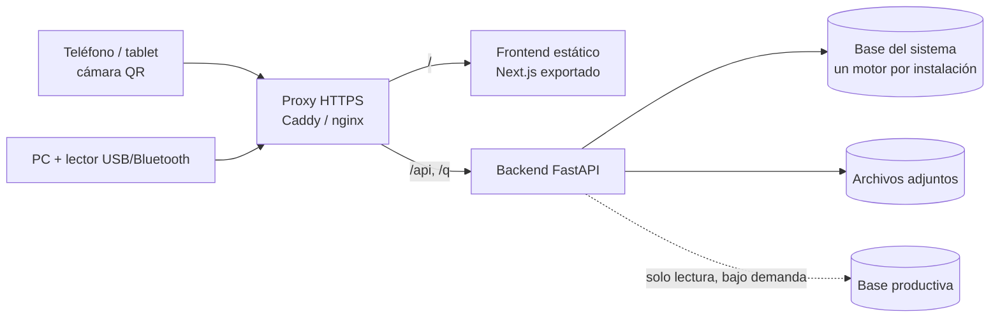

# Arquitectura

Monolito modular: un backend (API REST) y un frontend estático, servidos en el mismo origen.



## Backend

```
app/
  core/        config, db (motor único), seguridad, dependencias (RBAC), auditoría, crud genérico, migraciones
  modelos/     SQLAlchemy 2 — plataforma, maestros, lotes, inventario, procesos
  servicios/   reglas de negocio puras (sin HTTP)
  modulos/     rutas FastAPI: validan entrada, exigen permisos y llaman a los servicios
  semilla/     datos iniciales (permisos, roles, catálogos) y datos Demo
  tareas.py    tareas internas (APScheduler): alertas y sincronización automática
  cli.py       wms servir | demo | migrar | alertas | verificar | reiniciar-demo
```

Regla de dependencia: `modulos → servicios → modelos`. Los servicios no conocen HTTP y se prueban directamente
(así se prueban la concurrencia de lotes y de consumo con hilos).

| Módulo | Responsabilidad |
|---|---|
| instalacion | Asistente de primera ejecución |
| auth, usuarios | Sesiones, usuarios, roles, permisos, auditoría, parámetros |
| maestros, bodegas | Catálogos parametrizables, ubicaciones, plano |
| lotes | Plantillas versionadas, validación, lotes |
| inventario | Documentos, existencias, stock, movimientos |
| consumo | Escaneo, consumo rápido, etiquetas QR |
| reservas | Reservas y disponibilidad |
| procesos | Ciclo de vida, cierre, costeo |
| integraciones | Conexiones, fuentes, mapeo, importación |
| alertas, dashboard, reportes, trazabilidad | Analítica |
| operaciones, adjuntos | Conteos, préstamos, fraccionamiento, apertura, archivos |

## Frontend

Next.js (App Router) + TypeScript + Tailwind, **exportado como sitio estático**. No accede a la base: toda operación pasa por la API.

- `src/lib/api.ts`: cliente con token en memoria y renovación automática.
- `src/lib/sesion.tsx`: sesión, permisos (`puede("modulo:accion")`) y carga de datos.
- `src/components/ui.tsx`: componentes base. `Crud.tsx`: mantenedor genérico de maestros.
- `src/components/Escaner.tsx`: cámara (`BarcodeDetector` o jsQR) y lectores USB/Bluetooth.
- `src/components/plano/`: editor 2D (SVG) y visor 3D (React Three Fiber).
- El detalle de una entidad usa parámetros (`/procesos/detalle/?id=5`), no segmentos dinámicos, porque el sitio es estático.

## Decisiones técnicas

| # | Decisión | Alternativa | Por qué |
|---|---|---|---|
| 1 | Monolito modular | Microservicios | Las transacciones cruzan inventario, lotes y procesos; un equipo, una base |
| 2 | **Un motor por instalación**, elegido en el asistente | Varios motores simultáneos | Es el requisito real; solo se exige SQL portable |
| 3 | SQLAlchemy síncrono | Asíncrono | El controlador asíncrono de SQL Server es inmaduro; la carga esperada no lo requiere |
| 4 | Descuento de stock con `UPDATE … WHERE cantidad_fisica >= :q` | `SELECT … FOR UPDATE` | Atómico y portable a los cuatro motores |
| 5 | Reservas y salidas de un producto serializadas bloqueando la fila del producto | Bloqueos por tabla | Portable; consistente al medir el disponible |
| 6 | La existencia es la capa de costo | Tabla de capas | Identificación específica, sin estructuras duplicadas |
| 7 | El consumo es un movimiento con `proceso_id` | Tabla de consumos | Una sola fuente de verdad |
| 8 | Reservado se calcula desde `reservas_stock` | Contador en la existencia | Evita un segundo saldo que se desincronice |
| 9 | Frontend estático servido en el mismo origen | Servidor Node | Sin CORS, cookie `SameSite=Strict`, un proceso menos; el Demo corre con un comando |
| 10 | Componentes de interfaz escritos a mano (estilo shadcn/ui) y carga de datos propia | Generador de shadcn y TanStack Query | Menos dependencias; suficiente para el alcance |
| 11 | Respuestas de lectura como diccionarios, entradas con Pydantic | Esquemas de salida para todo | Menos código repetido; OpenAPI detalla las entradas |
| 12 | Rutas de API en español | Inglés | Coherencia con los nombres físicos |
| 13 | APScheduler en proceso | Airflow, Celery | El sistema debe ser autocontenido |
| 14 | Días contados en la zona horaria de la planta | UTC | A las 21:00 de Chile ya es "mañana" en UTC |
| 15 | En SQLite (Demo) las transacciones se ordenan con un candado del proceso | Espera por bloqueo de SQLite | La espera nativa no es justa y agota tiempos con muchos usuarios |
| 16 | Stock negativo no implementado | Parámetro + permiso | El requerimiento lo prohíbe por defecto; la base lo impide con `CHECK` |
| 17 | Una migración inicial regenerable hasta la versión 1.0 | Migraciones incrementales | Aún no hay instalaciones que migrar |

## Extensión

- **Nuevo tipo de inventario** (herramientas, EPP): crear familia y subfamilias con su configuración; no requiere código.
- **Nuevo módulo**: un archivo en `modulos/` (se registra en `MODULOS` de `main.py`), sus modelos y su servicio.
- **Canal de notificación**: `servicios.alertas.registrar_canal("EMAIL", funcion)`.
- **Multiempresa**: las tablas raíz ya llevan `empresa_id` y las consultas filtran por la empresa del usuario.
