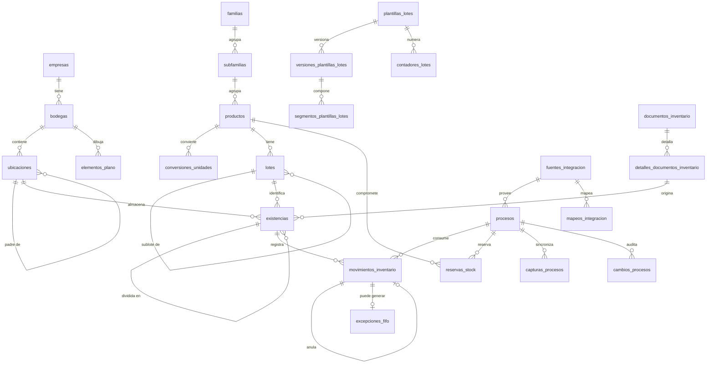

# Base de datos

> Documento generado desde los modelos (`python scripts/generar_docs.py`). No editar a mano.

## Criterios

- **Nombres fisicos en espanol**, `snake_case`, sin tildes ni ene.
- **Un motor por instalacion** (SQL Server, PostgreSQL, MySQL o SQLite en Modo Demo). Solo se usan tipos portables:
  `Integer`, `String`, `Numeric`, `DateTime`, `Date`, `Boolean`, `Text` y `JSON` generico (solo como bolsa de atributos, nunca en filtros de negocio).
- Cantidades y costos unitarios `NUMERIC(18,6)`; totales `NUMERIC(18,2)`. Nunca coma flotante.
- Fechas/hora en UTC sin zona. Los dias (vencimiento, antiguedad) se cuentan en la zona `WMS_ZONA_HORARIA`.
- `empresa_id` en las tablas raiz: el modelo no bloquea una futura operacion multiempresa.
- Sin borrado fisico en movimientos, lotes ni existencias. Los maestros usan baja logica (`activo`).
- La estructura se crea con migraciones Alembic (`backend/alembic/versions`).

## Modelo conceptual

## Invariantes

1. `existencias.cantidad_fisica = SUM(movimientos_inventario.cantidad)` de esa existencia. Lo verifica `wms verificar` y las pruebas.
2. `existencias.cantidad_fisica >= 0` (restriccion `CHECK`).
3. `SUM(movimientos_inventario.costo_total)` de una existencia agotada es exactamente 0.
4. Un movimiento se anula una sola vez (`UNIQUE movimiento_anulado_id`).
5. Un lote es unico por empresa (`UNIQUE empresa_id, codigo`); un contador es unico por plantilla y alcance.
6. Stock disponible = stock fisico - reservas ACTIVAS pendientes (`reservas_stock.cantidad - cantidad_consumida`).

## Tablas (52)

### Plataforma

#### `empresas`

| Columna | Tipo | Nulo | Referencia |
|---|---|---|---|
| `codigo` | String(20) | no |  |
| `nombre` | String(150) | no |  |
| `rut` | String(20) | si |  |
| `moneda` | String(3) | no |  |
| `zona_horaria` | String(50) | no |  |
| `idioma` | String(5) | no |  |
| `activo` | Boolean | no |  |
| `id` **PK** | Integer | no |  |
| `creado_en` | DateTime | no |  |
| `actualizado_en` | DateTime | no |  |

Unicos: (codigo); (codigo)

#### `usuarios`

| Columna | Tipo | Nulo | Referencia |
|---|---|---|---|
| `empresa_id` | Integer | no | `empresas.id` |
| `usuario` | String(60) | no |  |
| `nombre` | String(150) | no |  |
| `email` | String(150) | si |  |
| `clave_hash` | String(255) | no |  |
| `activo` | Boolean | no |  |
| `todas_bodegas` | Boolean | no |  |
| `todas_familias` | Boolean | no |  |
| `debe_cambiar_clave` | Boolean | no |  |
| `ultimo_acceso` | DateTime | si |  |
| `id` **PK** | Integer | no |  |
| `creado_en` | DateTime | no |  |
| `actualizado_en` | DateTime | no |  |

Unicos: (usuario); (usuario)

#### `roles`

| Columna | Tipo | Nulo | Referencia |
|---|---|---|---|
| `empresa_id` | Integer | no | `empresas.id` |
| `codigo` | String(40) | no |  |
| `nombre` | String(100) | no |  |
| `descripcion` | String(250) | si |  |
| `es_sistema` | Boolean | no |  |
| `id` **PK** | Integer | no |  |
| `creado_en` | DateTime | no |  |
| `actualizado_en` | DateTime | no |  |

Unicos: (empresa_id, codigo)

#### `permisos`

| Columna | Tipo | Nulo | Referencia |
|---|---|---|---|
| `codigo` | String(60) | no |  |
| `modulo` | String(30) | no |  |
| `accion` | String(30) | no |  |
| `descripcion` | String(200) | no |  |
| `especial` | Boolean | no |  |
| `id` **PK** | Integer | no |  |

Unicos: (codigo); (codigo)

#### `roles_permisos`

| Columna | Tipo | Nulo | Referencia |
|---|---|---|---|
| `rol_id` **PK** | Integer | no | `roles.id` |
| `permiso_id` **PK** | Integer | no | `permisos.id` |

#### `usuarios_roles`

| Columna | Tipo | Nulo | Referencia |
|---|---|---|---|
| `usuario_id` **PK** | Integer | no | `usuarios.id` |
| `rol_id` **PK** | Integer | no | `roles.id` |

#### `usuarios_bodegas`

| Columna | Tipo | Nulo | Referencia |
|---|---|---|---|
| `usuario_id` **PK** | Integer | no | `usuarios.id` |
| `bodega_id` **PK** | Integer | no | `bodegas.id` |

#### `usuarios_familias`

| Columna | Tipo | Nulo | Referencia |
|---|---|---|---|
| `usuario_id` **PK** | Integer | no | `usuarios.id` |
| `familia_id` **PK** | Integer | no | `familias.id` |

#### `sesiones`

| Columna | Tipo | Nulo | Referencia |
|---|---|---|---|
| `usuario_id` | Integer | no | `usuarios.id` |
| `token_hash` | String(64) | no |  |
| `creada_en` | DateTime | no |  |
| `expira_en` | DateTime | no |  |
| `revocada_en` | DateTime | si |  |
| `motivo_revocacion` | String(10) | si |  |
| `ip` | String(45) | si |  |
| `dispositivo` | String(250) | si |  |
| `id` **PK** | Integer | no |  |

Unicos: (token_hash); (token_hash)

Indices: (usuario_id)

#### `auditoria`

| Columna | Tipo | Nulo | Referencia |
|---|---|---|---|
| `empresa_id` | Integer | si |  |
| `usuario_id` | Integer | si | `usuarios.id` |
| `fecha` | DateTime | no |  |
| `ip` | String(45) | si |  |
| `dispositivo` | String(250) | si |  |
| `entidad` | String(60) | no |  |
| `entidad_id` | String(60) | si |  |
| `accion` | String(40) | no |  |
| `valor_anterior` | JSON | si |  |
| `valor_nuevo` | JSON | si |  |
| `motivo` | String(500) | si |  |
| `id` **PK** | Integer | no |  |

Indices: (usuario_id); (empresa_id); (entidad_id); (entidad); (fecha)

#### `configuraciones`

| Columna | Tipo | Nulo | Referencia |
|---|---|---|---|
| `empresa_id` | Integer | si | `empresas.id` |
| `clave` | String(80) | no |  |
| `valor` | JSON | si |  |
| `descripcion` | String(250) | si |  |
| `id` **PK** | Integer | no |  |
| `creado_en` | DateTime | no |  |
| `actualizado_en` | DateTime | no |  |

Unicos: (empresa_id, clave)

#### `adjuntos`

| Columna | Tipo | Nulo | Referencia |
|---|---|---|---|
| `empresa_id` | Integer | no | `empresas.id` |
| `entidad` | String(60) | no |  |
| `entidad_id` | Integer | no |  |
| `tipo` | String(30) | no |  |
| `nombre_archivo` | String(255) | no |  |
| `ruta` | String(500) | no |  |
| `mime` | String(100) | si |  |
| `tamano` | Integer | no |  |
| `sha256` | String(64) | si |  |
| `usuario_id` | Integer | si | `usuarios.id` |
| `creado_en` | DateTime | no |  |
| `descripcion` | Text | si |  |
| `id` **PK** | Integer | no |  |

Indices: (entidad_id); (entidad)

#### `secuencias`

| Columna | Tipo | Nulo | Referencia |
|---|---|---|---|
| `empresa_id` | Integer | no |  |
| `clave` | String(60) | no |  |
| `ultimo_valor` | Integer | no |  |
| `id` **PK** | Integer | no |  |

Unicos: (empresa_id, clave)

### Maestros

#### `temporadas`

| Columna | Tipo | Nulo | Referencia |
|---|---|---|---|
| `empresa_id` | Integer | no | `empresas.id` |
| `codigo` | String(20) | no |  |
| `nombre` | String(100) | no |  |
| `fecha_inicio` | Date | no |  |
| `fecha_termino` | Date | no |  |
| `actual` | Boolean | no |  |
| `activo` | Boolean | no |  |
| `id` **PK** | Integer | no |  |
| `creado_en` | DateTime | no |  |
| `actualizado_en` | DateTime | no |  |

Unicos: (empresa_id, codigo)

#### `unidades_medida`

| Columna | Tipo | Nulo | Referencia |
|---|---|---|---|
| `codigo` | String(15) | no |  |
| `nombre` | String(60) | no |  |
| `dimension` | String(15) | no |  |
| `decimales` | Integer | no |  |
| `activo` | Boolean | no |  |
| `id` **PK** | Integer | no |  |

Unicos: (codigo); (codigo)

#### `conversiones_unidades`

| Columna | Tipo | Nulo | Referencia |
|---|---|---|---|
| `producto_id` | Integer | si | `productos.id` |
| `unidad_origen_id` | Integer | no | `unidades_medida.id` |
| `unidad_destino_id` | Integer | no | `unidades_medida.id` |
| `factor` | Numeric(18, 8) | no |  |
| `id` **PK** | Integer | no |  |

Unicos: (producto_id, unidad_origen_id, unidad_destino_id)

Restricciones: `factor > 0`

Indices: (producto_id)

#### `familias`

| Columna | Tipo | Nulo | Referencia |
|---|---|---|---|
| `empresa_id` | Integer | no | `empresas.id` |
| `codigo` | String(20) | no |  |
| `nombre` | String(100) | no |  |
| `descripcion` | String(250) | si |  |
| `activo` | Boolean | no |  |
| `id` **PK** | Integer | no |  |
| `creado_en` | DateTime | no |  |
| `actualizado_en` | DateTime | no |  |
| `usa_lote` | Boolean | si |  |
| `usa_vencimiento` | Boolean | si |  |
| `usa_serie` | Boolean | si |  |
| `requiere_qr` | Boolean | si |  |
| `requiere_ubicacion` | Boolean | si |  |
| `granularidad` | String(20) | si |  |
| `estrategia_salida` | String(20) | si |  |
| `politica_fifo` | String(20) | si |  |
| `vida_util_meses` | Integer | si |  |
| `prioridad_vencimiento` | String(12) | si |  |
| `vida_util_abierto_dias` | Integer | si |  |
| `plantilla_lote_id` | Integer | si |  |
| `permite_sublotes` | Boolean | si |  |

Unicos: (empresa_id, codigo)

#### `subfamilias`

| Columna | Tipo | Nulo | Referencia |
|---|---|---|---|
| `familia_id` | Integer | no | `familias.id` |
| `codigo` | String(20) | no |  |
| `nombre` | String(100) | no |  |
| `descripcion` | String(250) | si |  |
| `activo` | Boolean | no |  |
| `id` **PK** | Integer | no |  |
| `creado_en` | DateTime | no |  |
| `actualizado_en` | DateTime | no |  |
| `usa_lote` | Boolean | si |  |
| `usa_vencimiento` | Boolean | si |  |
| `usa_serie` | Boolean | si |  |
| `requiere_qr` | Boolean | si |  |
| `requiere_ubicacion` | Boolean | si |  |
| `granularidad` | String(20) | si |  |
| `estrategia_salida` | String(20) | si |  |
| `politica_fifo` | String(20) | si |  |
| `vida_util_meses` | Integer | si |  |
| `prioridad_vencimiento` | String(12) | si |  |
| `vida_util_abierto_dias` | Integer | si |  |
| `plantilla_lote_id` | Integer | si |  |
| `permite_sublotes` | Boolean | si |  |

Unicos: (familia_id, codigo)

Indices: (familia_id)

#### `definiciones_atributos`

| Columna | Tipo | Nulo | Referencia |
|---|---|---|---|
| `familia_id` | Integer | no | `familias.id` |
| `clave` | String(40) | no |  |
| `etiqueta` | String(80) | no |  |
| `tipo` | String(15) | no |  |
| `requerido` | Boolean | no |  |
| `opciones` | JSON | si |  |
| `id` **PK** | Integer | no |  |

Unicos: (familia_id, clave)

#### `productos`

| Columna | Tipo | Nulo | Referencia |
|---|---|---|---|
| `empresa_id` | Integer | no | `empresas.id` |
| `codigo` | String(30) | no |  |
| `codigo_externo` | String(50) | si |  |
| `nombre` | String(150) | no |  |
| `descripcion` | Text | si |  |
| `subfamilia_id` | Integer | no | `subfamilias.id` |
| `categoria` | String(60) | si |  |
| `marca` | String(60) | si |  |
| `proveedor_id` | Integer | si | `proveedores.id` |
| `unidad_base_id` | Integer | no | `unidades_medida.id` |
| `unidad_compra_id` | Integer | si | `unidades_medida.id` |
| `unidad_consumo_id` | Integer | si | `unidades_medida.id` |
| `costo_referencial` | Numeric(18, 6) | si |  |
| `moneda` | String(3) | no |  |
| `stock_minimo` | Numeric(18, 6) | si |  |
| `stock_critico` | Numeric(18, 6) | si |  |
| `stock_maximo` | Numeric(18, 6) | si |  |
| `punto_reposicion` | Numeric(18, 6) | si |  |
| `codigo_barras` | String(60) | si |  |
| `atributos` | JSON | si |  |
| `activo` | Boolean | no |  |
| `version_stock` | Integer | no |  |
| `id` **PK** | Integer | no |  |
| `creado_en` | DateTime | no |  |
| `actualizado_en` | DateTime | no |  |
| `usa_lote` | Boolean | si |  |
| `usa_vencimiento` | Boolean | si |  |
| `usa_serie` | Boolean | si |  |
| `requiere_qr` | Boolean | si |  |
| `requiere_ubicacion` | Boolean | si |  |
| `granularidad` | String(20) | si |  |
| `estrategia_salida` | String(20) | si |  |
| `politica_fifo` | String(20) | si |  |
| `vida_util_meses` | Integer | si |  |
| `prioridad_vencimiento` | String(12) | si |  |
| `vida_util_abierto_dias` | Integer | si |  |
| `plantilla_lote_id` | Integer | si |  |
| `permite_sublotes` | Boolean | si |  |

Unicos: (empresa_id, codigo)

Indices: (nombre); (subfamilia_id); (codigo_barras)

#### `proveedores`

| Columna | Tipo | Nulo | Referencia |
|---|---|---|---|
| `empresa_id` | Integer | no | `empresas.id` |
| `codigo` | String(20) | no |  |
| `nombre` | String(150) | no |  |
| `rut` | String(20) | si |  |
| `contacto` | String(150) | si |  |
| `activo` | Boolean | no |  |
| `id` **PK** | Integer | no |  |
| `creado_en` | DateTime | no |  |
| `actualizado_en` | DateTime | no |  |

Unicos: (empresa_id, codigo)

#### `tipos_bodega`

| Columna | Tipo | Nulo | Referencia |
|---|---|---|---|
| `codigo` | String(20) | no |  |
| `nombre` | String(80) | no |  |
| `id` **PK** | Integer | no |  |

Unicos: (codigo); (codigo)

#### `bodegas`

| Columna | Tipo | Nulo | Referencia |
|---|---|---|---|
| `empresa_id` | Integer | no | `empresas.id` |
| `codigo` | String(10) | no |  |
| `nombre` | String(100) | no |  |
| `tipo_bodega_id` | Integer | si | `tipos_bodega.id` |
| `largo` | Numeric(8, 2) | si |  |
| `ancho` | Numeric(8, 2) | si |  |
| `alto` | Numeric(8, 2) | si |  |
| `niveles` | JSON | si |  |
| `direccion` | String(200) | si |  |
| `activo` | Boolean | no |  |
| `id` **PK** | Integer | no |  |
| `creado_en` | DateTime | no |  |
| `actualizado_en` | DateTime | no |  |

Unicos: (empresa_id, codigo)

#### `ubicaciones`

| Columna | Tipo | Nulo | Referencia |
|---|---|---|---|
| `bodega_id` | Integer | no | `bodegas.id` |
| `padre_id` | Integer | si | `ubicaciones.id` |
| `tipo` | String(20) | no |  |
| `nivel` | Integer | no |  |
| `orden` | Integer | no |  |
| `codigo` | String(20) | no |  |
| `codigo_completo` | String(80) | no |  |
| `nombre` | String(100) | si |  |
| `capacidad` | Numeric(18, 6) | si |  |
| `almacenable` | Boolean | no |  |
| `activo` | Boolean | no |  |
| `id` **PK** | Integer | no |  |
| `creado_en` | DateTime | no |  |
| `actualizado_en` | DateTime | no |  |

Unicos: (bodega_id, codigo_completo)

Indices: (bodega_id); (codigo_completo); (padre_id)

#### `elementos_plano`

| Columna | Tipo | Nulo | Referencia |
|---|---|---|---|
| `bodega_id` | Integer | no | `bodegas.id` |
| `ubicacion_id` | Integer | si | `ubicaciones.id` |
| `tipo` | String(15) | no |  |
| `nombre` | String(60) | no |  |
| `x` | Numeric(8, 2) | no |  |
| `y` | Numeric(8, 2) | no |  |
| `ancho` | Numeric(8, 2) | no |  |
| `fondo` | Numeric(8, 2) | no |  |
| `alto` | Numeric(8, 2) | no |  |
| `rotacion` | Integer | no |  |
| `color` | String(9) | si |  |
| `parametros` | JSON | si |  |
| `id` **PK** | Integer | no |  |
| `creado_en` | DateTime | no |  |
| `actualizado_en` | DateTime | no |  |

Indices: (bodega_id)

#### `tipos_movimiento`

| Columna | Tipo | Nulo | Referencia |
|---|---|---|---|
| `codigo` | String(25) | no |  |
| `nombre` | String(80) | no |  |
| `signo` | Integer | no |  |
| `es_sistema` | Boolean | no |  |
| `activo` | Boolean | no |  |
| `id` **PK** | Integer | no |  |

Unicos: (codigo); (codigo)

#### `motivos_movimiento`

| Columna | Tipo | Nulo | Referencia |
|---|---|---|---|
| `clase` | String(10) | no |  |
| `codigo` | String(25) | no |  |
| `nombre` | String(80) | no |  |
| `tipo_movimiento_id` | Integer | no | `tipos_movimiento.id` |
| `requiere_proceso` | Boolean | no |  |
| `requiere_documento` | Boolean | no |  |
| `activo` | Boolean | no |  |
| `id` **PK** | Integer | no |  |

Unicos: (clase, codigo)

#### `plantillas_etiquetas`

| Columna | Tipo | Nulo | Referencia |
|---|---|---|---|
| `nombre` | String(60) | no |  |
| `ancho_mm` | Integer | no |  |
| `alto_mm` | Integer | no |  |
| `campos` | JSON | no |  |
| `predeterminada` | Boolean | no |  |
| `id` **PK** | Integer | no |  |

Unicos: (nombre); (nombre)

### Lotes

#### `plantillas_lotes`

| Columna | Tipo | Nulo | Referencia |
|---|---|---|---|
| `empresa_id` | Integer | no | `empresas.id` |
| `codigo` | String(30) | no |  |
| `nombre` | String(100) | no |  |
| `descripcion` | String(250) | si |  |
| `modo` | String(15) | no |  |
| `momento_creacion` | String(25) | no |  |
| `activa` | Boolean | no |  |
| `id` **PK** | Integer | no |  |
| `creado_en` | DateTime | no |  |
| `actualizado_en` | DateTime | no |  |

Unicos: (empresa_id, codigo)

#### `versiones_plantillas_lotes`

| Columna | Tipo | Nulo | Referencia |
|---|---|---|---|
| `plantilla_id` | Integer | no | `plantillas_lotes.id` |
| `version` | Integer | no |  |
| `estado` | String(10) | no |  |
| `vigente_desde` | DateTime | si |  |
| `vigente_hasta` | DateTime | si |  |
| `alcance` | JSON | no |  |
| `reinicio` | String(10) | no |  |
| `epoca` | Integer | no |  |
| `creado_en` | DateTime | no |  |
| `id` **PK** | Integer | no |  |

Unicos: (plantilla_id, version)

#### `segmentos_plantillas_lotes`

| Columna | Tipo | Nulo | Referencia |
|---|---|---|---|
| `version_id` | Integer | no | `versiones_plantillas_lotes.id` |
| `posicion` | Integer | no |  |
| `tipo` | String(25) | no |  |
| `configuracion` | JSON | no |  |
| `id` **PK** | Integer | no |  |

Indices: (version_id)

#### `contadores_lotes`

| Columna | Tipo | Nulo | Referencia |
|---|---|---|---|
| `plantilla_id` | Integer | no | `plantillas_lotes.id` |
| `clave_alcance` | String(200) | no |  |
| `ultimo_valor` | Integer | no |  |
| `id` **PK** | Integer | no |  |

Unicos: (plantilla_id, clave_alcance)

#### `lotes`

| Columna | Tipo | Nulo | Referencia |
|---|---|---|---|
| `empresa_id` | Integer | no | `empresas.id` |
| `codigo` | String(60) | no |  |
| `producto_id` | Integer | no | `productos.id` |
| `version_plantilla_id` | Integer | si | `versiones_plantillas_lotes.id` |
| `lote_padre_id` | Integer | si | `lotes.id` |
| `fecha_creacion` | DateTime | no |  |
| `fecha_ingreso` | DateTime | si |  |
| `fecha_fabricacion` | Date | si |  |
| `fecha_vencimiento` | Date | si |  |
| `estado` | String(12) | no |  |
| `referencia_externa` | String(80) | si |  |
| `documento_origen_id` | Integer | si |  |
| `usuario_id` | Integer | si | `usuarios.id` |
| `observaciones` | Text | si |  |
| `id` **PK** | Integer | no |  |
| `creado_en` | DateTime | no |  |
| `actualizado_en` | DateTime | no |  |

Unicos: (empresa_id, codigo)

Indices: (codigo); (fecha_vencimiento); (lote_padre_id); (estado); (producto_id)

#### `historial_estados_lotes`

| Columna | Tipo | Nulo | Referencia |
|---|---|---|---|
| `lote_id` | Integer | no | `lotes.id` |
| `estado_anterior` | String(12) | si |  |
| `estado_nuevo` | String(12) | no |  |
| `usuario_id` | Integer | si | `usuarios.id` |
| `fecha` | DateTime | no |  |
| `motivo` | String(300) | si |  |
| `id` **PK** | Integer | no |  |

Indices: (lote_id)

### Inventario

#### `documentos_inventario`

| Columna | Tipo | Nulo | Referencia |
|---|---|---|---|
| `empresa_id` | Integer | no | `empresas.id` |
| `numero` | String(20) | no |  |
| `clase` | String(10) | no |  |
| `motivo_id` | Integer | si | `motivos_movimiento.id` |
| `tipo_documento` | String(20) | si |  |
| `numero_documento` | String(40) | si |  |
| `fecha_documento` | Date | si |  |
| `fecha` | DateTime | no |  |
| `proveedor_id` | Integer | si | `proveedores.id` |
| `bodega_id` | Integer | no | `bodegas.id` |
| `bodega_destino_id` | Integer | si | `bodegas.id` |
| `proceso_id` | Integer | si | `procesos.id` |
| `temporada_id` | Integer | si | `temporadas.id` |
| `estado` | String(10) | no |  |
| `moneda` | String(3) | no |  |
| `observaciones` | Text | si |  |
| `usuario_id` | Integer | si | `usuarios.id` |
| `confirmado_en` | DateTime | si |  |
| `confirmado_por` | Integer | si | `usuarios.id` |
| `anulado_en` | DateTime | si |  |
| `anulado_por` | Integer | si | `usuarios.id` |
| `motivo_anulacion` | String(300) | si |  |
| `id` **PK** | Integer | no |  |
| `creado_en` | DateTime | no |  |
| `actualizado_en` | DateTime | no |  |

Unicos: (empresa_id, numero)

Indices: (fecha); (estado); (clase); (numero_documento); (bodega_id)

#### `detalles_documentos_inventario`

| Columna | Tipo | Nulo | Referencia |
|---|---|---|---|
| `documento_id` | Integer | no | `documentos_inventario.id` |
| `producto_id` | Integer | no | `productos.id` |
| `cantidad` | Numeric(18, 6) | no |  |
| `unidad_id` | Integer | no | `unidades_medida.id` |
| `precio_unitario` | Numeric(18, 6) | si |  |
| `cantidad_base` | Numeric(18, 6) | si |  |
| `costo_unitario_base` | Numeric(18, 6) | si |  |
| `costo_total` | Numeric(18, 2) | si |  |
| `lote_id` | Integer | si | `lotes.id` |
| `lote_manual` | String(60) | si |  |
| `campos_lote` | Text | si |  |
| `referencia_externa` | String(80) | si |  |
| `fecha_fabricacion` | Date | si |  |
| `fecha_vencimiento` | Date | si |  |
| `ubicacion_id` | Integer | si | `ubicaciones.id` |
| `ubicacion_destino_id` | Integer | si | `ubicaciones.id` |
| `existencia_id` | Integer | si | `existencias.id` |
| `bultos` | Integer | si |  |
| `observaciones` | String(300) | si |  |
| `id` **PK** | Integer | no |  |

Indices: (documento_id)

#### `existencias`

| Columna | Tipo | Nulo | Referencia |
|---|---|---|---|
| `empresa_id` | Integer | no | `empresas.id` |
| `codigo_publico` | String(20) | no |  |
| `token_qr` | String(40) | no |  |
| `producto_id` | Integer | no | `productos.id` |
| `lote_id` | Integer | si | `lotes.id` |
| `bodega_id` | Integer | no | `bodegas.id` |
| `ubicacion_id` | Integer | si | `ubicaciones.id` |
| `detalle_origen_id` | Integer | si | `detalles_documentos_inventario.id` |
| `existencia_padre_id` | Integer | si | `existencias.id` |
| `granularidad` | String(20) | no |  |
| `envases` | Integer | si |  |
| `fecha_ingreso` | DateTime | no |  |
| `cantidad_inicial` | Numeric(18, 6) | no |  |
| `cantidad_fisica` | Numeric(18, 6) | no |  |
| `unidad_id` | Integer | no | `unidades_medida.id` |
| `costo_unitario` | Numeric(18, 6) | no |  |
| `moneda` | String(3) | no |  |
| `fecha_costo` | Date | si |  |
| `proveedor_id` | Integer | si | `proveedores.id` |
| `estado` | String(12) | no |  |
| `fecha_apertura` | DateTime | si |  |
| `abierta_por` | Integer | si | `usuarios.id` |
| `vence_abierta` | Date | si |  |
| `etiquetas_impresas` | Integer | no |  |
| `version` | Integer | no |  |
| `id` **PK** | Integer | no |  |
| `creado_en` | DateTime | no |  |
| `actualizado_en` | DateTime | no |  |

Unicos: (token_qr); (codigo_publico); (codigo_publico); (token_qr)

Restricciones: `cantidad_inicial > 0`; `cantidad_fisica >= 0`; `costo_unitario >= 0`

Indices: (lote_id); (producto_id, bodega_id, estado, fecha_ingreso); (ubicacion_id); (existencia_padre_id)

#### `movimientos_inventario`

| Columna | Tipo | Nulo | Referencia |
|---|---|---|---|
| `empresa_id` | Integer | no | `empresas.id` |
| `fecha` | DateTime | no |  |
| `tipo_movimiento_id` | Integer | no | `tipos_movimiento.id` |
| `motivo_id` | Integer | si | `motivos_movimiento.id` |
| `existencia_id` | Integer | no | `existencias.id` |
| `producto_id` | Integer | no | `productos.id` |
| `lote_id` | Integer | si | `lotes.id` |
| `cantidad` | Numeric(18, 6) | no |  |
| `unidad_id` | Integer | no | `unidades_medida.id` |
| `cantidad_ingresada` | Numeric(18, 6) | si |  |
| `unidad_ingresada_id` | Integer | si | `unidades_medida.id` |
| `costo_unitario` | Numeric(18, 6) | no |  |
| `costo_total` | Numeric(18, 2) | no |  |
| `bodega_origen_id` | Integer | si | `bodegas.id` |
| `bodega_destino_id` | Integer | si | `bodegas.id` |
| `ubicacion_origen_id` | Integer | si | `ubicaciones.id` |
| `ubicacion_destino_id` | Integer | si | `ubicaciones.id` |
| `proceso_id` | Integer | si | `procesos.id` |
| `temporada_id` | Integer | si | `temporadas.id` |
| `documento_id` | Integer | si | `documentos_inventario.id` |
| `detalle_documento_id` | Integer | si | `detalles_documentos_inventario.id` |
| `reserva_id` | Integer | si | `reservas_stock.id` |
| `movimiento_anulado_id` | Integer | si | `movimientos_inventario.id` |
| `usuario_id` | Integer | si | `usuarios.id` |
| `motivo_texto` | String(300) | si |  |
| `observacion` | String(300) | si |  |
| `clave_idempotencia` | String(64) | si |  |
| `id` **PK** | Integer | no |  |

Unicos: (movimiento_anulado_id); (clave_idempotencia)

Indices: (documento_id); (proceso_id); (bodega_origen_id); (existencia_id); (fecha); (producto_id, fecha); (lote_id); (bodega_destino_id)

#### `excepciones_fifo`

| Columna | Tipo | Nulo | Referencia |
|---|---|---|---|
| `movimiento_id` | Integer | no | `movimientos_inventario.id` |
| `existencia_recomendada_id` | Integer | no | `existencias.id` |
| `estrategia` | String(20) | no |  |
| `politica` | String(20) | no |  |
| `justificacion` | String(300) | si |  |
| `usuario_id` | Integer | si | `usuarios.id` |
| `fecha` | DateTime | no |  |
| `id` **PK** | Integer | no |  |

Unicos: (movimiento_id); (movimiento_id)

#### `reservas_stock`

| Columna | Tipo | Nulo | Referencia |
|---|---|---|---|
| `empresa_id` | Integer | no | `empresas.id` |
| `numero` | String(20) | no |  |
| `producto_id` | Integer | no | `productos.id` |
| `bodega_id` | Integer | si | `bodegas.id` |
| `lote_id` | Integer | si | `lotes.id` |
| `existencia_id` | Integer | si | `existencias.id` |
| `proceso_id` | Integer | si | `procesos.id` |
| `area` | String(80) | si |  |
| `documento_referencia` | String(60) | si |  |
| `motivo` | String(300) | si |  |
| `cantidad` | Numeric(18, 6) | no |  |
| `cantidad_consumida` | Numeric(18, 6) | no |  |
| `unidad_id` | Integer | no | `unidades_medida.id` |
| `fecha` | DateTime | no |  |
| `fecha_vencimiento` | DateTime | si |  |
| `estado` | String(10) | no |  |
| `usuario_id` | Integer | si | `usuarios.id` |
| `cerrada_por` | Integer | si | `usuarios.id` |
| `fecha_cierre` | DateTime | si |  |
| `observacion` | String(300) | si |  |
| `id` **PK** | Integer | no |  |
| `creado_en` | DateTime | no |  |
| `actualizado_en` | DateTime | no |  |

Unicos: (empresa_id, numero)

Restricciones: `cantidad_consumida >= 0`; `cantidad > 0`

Indices: (producto_id); (estado); (proceso_id)

#### `conteos_inventario`

| Columna | Tipo | Nulo | Referencia |
|---|---|---|---|
| `empresa_id` | Integer | no | `empresas.id` |
| `numero` | String(20) | no |  |
| `bodega_id` | Integer | no | `bodegas.id` |
| `ubicacion_id` | Integer | si | `ubicaciones.id` |
| `estado` | String(12) | no |  |
| `fecha` | DateTime | no |  |
| `usuario_id` | Integer | si | `usuarios.id` |
| `autorizado_por` | Integer | si | `usuarios.id` |
| `fecha_autorizacion` | DateTime | si |  |
| `observaciones` | Text | si |  |
| `id` **PK** | Integer | no |  |
| `creado_en` | DateTime | no |  |
| `actualizado_en` | DateTime | no |  |

Unicos: (empresa_id, numero)

#### `detalles_conteos_inventario`

| Columna | Tipo | Nulo | Referencia |
|---|---|---|---|
| `conteo_id` | Integer | no | `conteos_inventario.id` |
| `existencia_id` | Integer | no | `existencias.id` |
| `producto_id` | Integer | no | `productos.id` |
| `cantidad_sistema` | Numeric(18, 6) | no |  |
| `cantidad_contada` | Numeric(18, 6) | si |  |
| `diferencia` | Numeric(18, 6) | si |  |
| `movimiento_ajuste_id` | Integer | si | `movimientos_inventario.id` |
| `observacion` | String(300) | si |  |
| `contado_en` | DateTime | si |  |
| `id` **PK** | Integer | no |  |

Unicos: (conteo_id, existencia_id)

Indices: (conteo_id)

#### `prestamos`

| Columna | Tipo | Nulo | Referencia |
|---|---|---|---|
| `empresa_id` | Integer | no | `empresas.id` |
| `numero` | String(20) | no |  |
| `existencia_id` | Integer | no | `existencias.id` |
| `producto_id` | Integer | no | `productos.id` |
| `cantidad` | Numeric(18, 6) | no |  |
| `cantidad_devuelta` | Numeric(18, 6) | no |  |
| `persona` | String(120) | no |  |
| `area` | String(80) | si |  |
| `fecha_prestamo` | DateTime | no |  |
| `fecha_devolucion_esperada` | Date | si |  |
| `fecha_devolucion_real` | DateTime | si |  |
| `estado` | String(10) | no |  |
| `observacion` | String(300) | si |  |
| `usuario_id` | Integer | si | `usuarios.id` |
| `movimiento_salida_id` | Integer | si | `movimientos_inventario.id` |
| `id` **PK** | Integer | no |  |
| `creado_en` | DateTime | no |  |
| `actualizado_en` | DateTime | no |  |

Unicos: (empresa_id, numero)

### Procesos e integracion

#### `procesos`

| Columna | Tipo | Nulo | Referencia |
|---|---|---|---|
| `empresa_id` | Integer | no | `empresas.id` |
| `fuente_id` | Integer | si | `fuentes_integracion.id` |
| `id_externo` | String(80) | si |  |
| `codigo` | String(40) | no |  |
| `numero` | String(40) | si |  |
| `tipo` | String(40) | si |  |
| `fecha` | Date | si |  |
| `hora_inicio` | String(20) | si |  |
| `hora_termino` | String(20) | si |  |
| `temporada_id` | Integer | si | `temporadas.id` |
| `temporada` | String(20) | si |  |
| `estado` | String(10) | no |  |
| `estado_externo` | String(40) | si |  |
| `exportadora` | String(120) | si |  |
| `productor` | String(150) | si |  |
| `codigo_productor` | String(40) | si |  |
| `campo` | String(120) | si |  |
| `predio` | String(120) | si |  |
| `especie` | String(80) | si |  |
| `variedad` | String(80) | si |  |
| `lote_productivo` | String(80) | si |  |
| `numero_lote` | String(40) | si |  |
| `kilos_recepcionados` | Numeric(18, 6) | si |  |
| `kilos_procesados` | Numeric(18, 6) | si |  |
| `kilos_producidos` | Numeric(18, 6) | si |  |
| `kilos_despachados` | Numeric(18, 6) | si |  |
| `cantidad` | Numeric(18, 6) | si |  |
| `bins` | Numeric(18, 6) | si |  |
| `cajas` | Numeric(18, 6) | si |  |
| `turno` | String(40) | si |  |
| `linea` | String(40) | si |  |
| `guia` | String(40) | si |  |
| `recepcion_relacionada` | String(60) | si |  |
| `datos_adicionales` | JSON | si |  |
| `base_costeo` | String(40) | si |  |
| `estado_kilos` | String(12) | no |  |
| `kilos_definitivos` | Numeric(18, 6) | si |  |
| `ultima_sincronizacion` | DateTime | si |  |
| `abierto_en` | DateTime | si |  |
| `abierto_por` | Integer | si | `usuarios.id` |
| `cerrado_en` | DateTime | si |  |
| `cerrado_por` | Integer | si | `usuarios.id` |
| `modo_cierre` | String(15) | si |  |
| `cerrado_sincronizado` | Boolean | si |  |
| `observaciones` | Text | si |  |
| `version` | Integer | no |  |
| `id` **PK** | Integer | no |  |
| `creado_en` | DateTime | no |  |
| `actualizado_en` | DateTime | no |  |

Unicos: (fuente_id, id_externo); (empresa_id, codigo)

Indices: (estado); (exportadora); (especie); (temporada_id); (productor); (codigo); (fecha)

#### `capturas_procesos`

| Columna | Tipo | Nulo | Referencia |
|---|---|---|---|
| `proceso_id` | Integer | no | `procesos.id` |
| `ejecucion_id` | Integer | si | `ejecuciones_sincronizacion.id` |
| `fecha` | DateTime | no |  |
| `datos` | JSON | no |  |
| `id` **PK** | Integer | no |  |

Indices: (proceso_id)

#### `cambios_procesos`

| Columna | Tipo | Nulo | Referencia |
|---|---|---|---|
| `proceso_id` | Integer | no | `procesos.id` |
| `campo` | String(60) | no |  |
| `valor_anterior` | String(300) | si |  |
| `valor_nuevo` | String(300) | si |  |
| `origen` | String(15) | no |  |
| `fecha` | DateTime | no |  |
| `usuario_id` | Integer | si | `usuarios.id` |
| `ejecucion_id` | Integer | si | `ejecuciones_sincronizacion.id` |
| `id` **PK** | Integer | no |  |

Indices: (proceso_id)

#### `conexiones_integracion`

| Columna | Tipo | Nulo | Referencia |
|---|---|---|---|
| `empresa_id` | Integer | no | `empresas.id` |
| `nombre` | String(80) | no |  |
| `motor` | String(15) | no |  |
| `servidor` | String(150) | si |  |
| `puerto` | Integer | si |  |
| `base_datos` | String(100) | si |  |
| `usuario` | String(100) | si |  |
| `clave_cifrada` | Text | si |  |
| `parametros` | JSON | si |  |
| `activa` | Boolean | no |  |
| `id` **PK** | Integer | no |  |
| `creado_en` | DateTime | no |  |
| `actualizado_en` | DateTime | no |  |

Unicos: (empresa_id, nombre)

#### `fuentes_integracion`

| Columna | Tipo | Nulo | Referencia |
|---|---|---|---|
| `conexion_id` | Integer | no | `conexiones_integracion.id` |
| `nombre` | String(80) | no |  |
| `tipo` | String(10) | no |  |
| `origen` | Text | no |  |
| `columna_id` | String(80) | no |  |
| `columna_fecha` | String(80) | si |  |
| `intervalo_minutos` | Integer | si |  |
| `guardar_no_mapeadas` | Boolean | no |  |
| `activa` | Boolean | no |  |
| `id` **PK** | Integer | no |  |
| `creado_en` | DateTime | no |  |
| `actualizado_en` | DateTime | no |  |

#### `mapeos_integracion`

| Columna | Tipo | Nulo | Referencia |
|---|---|---|---|
| `fuente_id` | Integer | no | `fuentes_integracion.id` |
| `columna_externa` | String(80) | no |  |
| `campo_interno` | String(80) | no |  |
| `transformacion` | String(30) | si |  |
| `factor` | Numeric(18, 6) | si |  |
| `politica_actualizacion` | String(15) | no |  |
| `id` **PK** | Integer | no |  |

Unicos: (fuente_id, campo_interno)

Indices: (fuente_id)

#### `ejecuciones_sincronizacion`

| Columna | Tipo | Nulo | Referencia |
|---|---|---|---|
| `fuente_id` | Integer | si | `fuentes_integracion.id` |
| `proceso_id` | Integer | si |  |
| `accion` | String(15) | no |  |
| `inicio` | DateTime | no |  |
| `termino` | DateTime | si |  |
| `estado` | String(10) | no |  |
| `filas` | Integer | no |  |
| `cambios` | Integer | no |  |
| `error` | Text | si |  |
| `usuario_id` | Integer | si | `usuarios.id` |
| `id` **PK** | Integer | no |  |

### Alertas

#### `reglas_alertas`

| Columna | Tipo | Nulo | Referencia |
|---|---|---|---|
| `empresa_id` | Integer | no | `empresas.id` |
| `tipo` | String(40) | no |  |
| `nombre` | String(100) | no |  |
| `activa` | Boolean | no |  |
| `severidad` | String(12) | no |  |
| `parametros` | JSON | si |  |
| `canales` | JSON | si |  |
| `id` **PK** | Integer | no |  |
| `creado_en` | DateTime | no |  |
| `actualizado_en` | DateTime | no |  |

Unicos: (empresa_id, tipo)

#### `alertas`

| Columna | Tipo | Nulo | Referencia |
|---|---|---|---|
| `empresa_id` | Integer | no | `empresas.id` |
| `tipo` | String(40) | no |  |
| `severidad` | String(12) | no |  |
| `titulo` | String(200) | no |  |
| `descripcion` | Text | si |  |
| `fecha_creacion` | DateTime | no |  |
| `fecha_vencimiento` | DateTime | si |  |
| `entidad` | String(40) | si |  |
| `entidad_id` | Integer | si |  |
| `clave` | String(120) | no |  |
| `usuario_id` | Integer | si | `usuarios.id` |
| `bodega_id` | Integer | si | `bodegas.id` |
| `estado` | String(12) | no |  |
| `resuelta_por` | Integer | si | `usuarios.id` |
| `fecha_resolucion` | DateTime | si |  |
| `observacion` | String(500) | si |  |
| `notificada` | Boolean | no |  |
| `id` **PK** | Integer | no |  |

Indices: (tipo); (clave); (estado); (empresa_id); (fecha_creacion)
